<!-- ===================== HEADER ===================== -->

  

<!-- ===================== STATS ===================== -->

  

   
  

<!-- ===================== LANGUAGES & TOOLS ===================== -->

  

   
  
  

    
     
    
    
  

<!-- ===================== PACMAN ===================== -->

  

  <picture>
    <source media="(prefers-color-scheme: dark)" srcset="https://raw.githubusercontent.com/174gb/174gb/output-pacman/pacman-contribution-graph-dark.svg" />
    <source media="(prefers-color-scheme: light)" srcset="https://raw.githubusercontent.com/174gb/174gb/output-pacman/pacman-contribution-graph.svg" />
    
  </picture>

